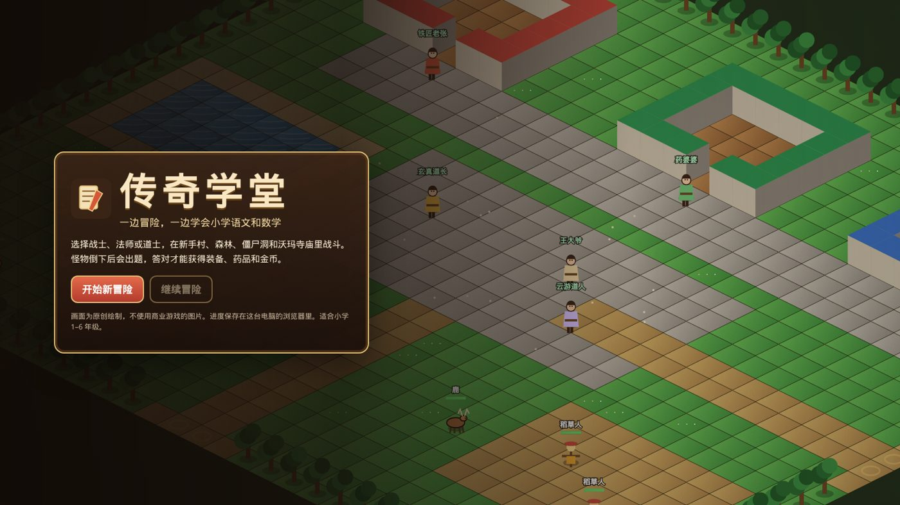
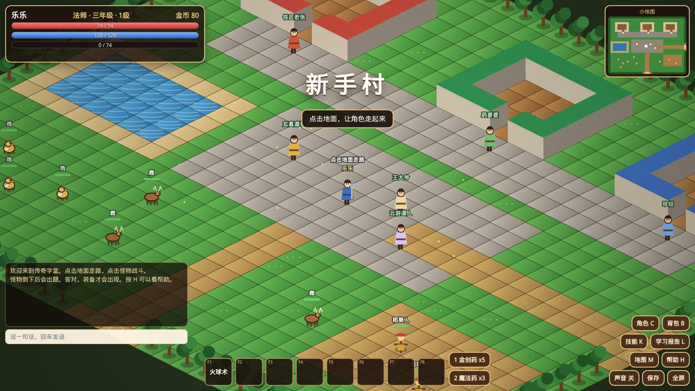
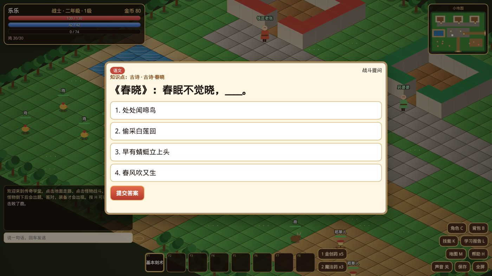
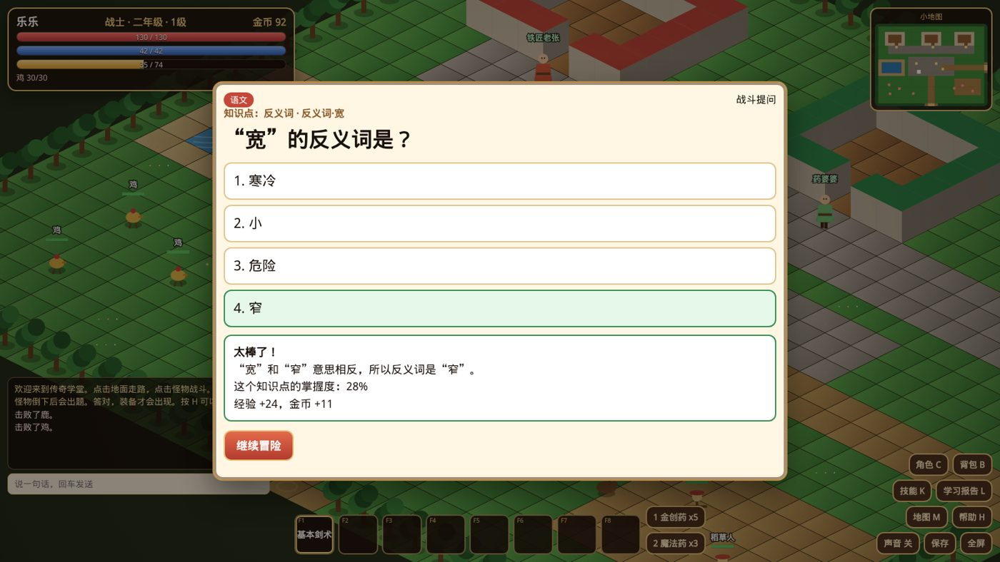
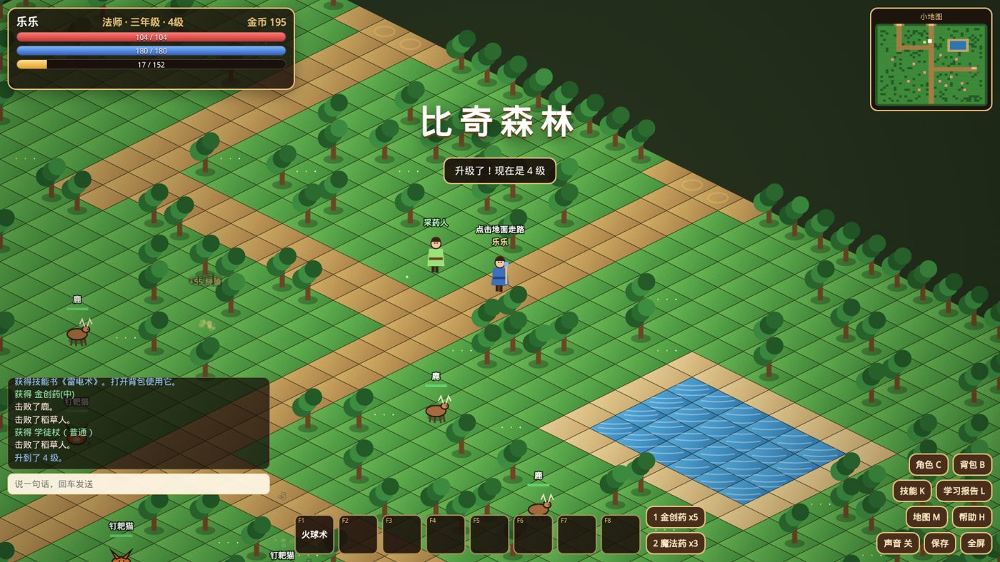
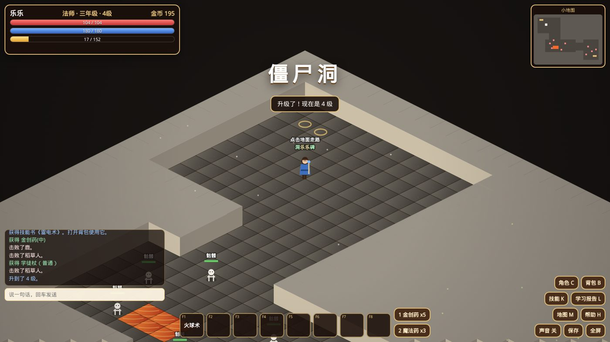
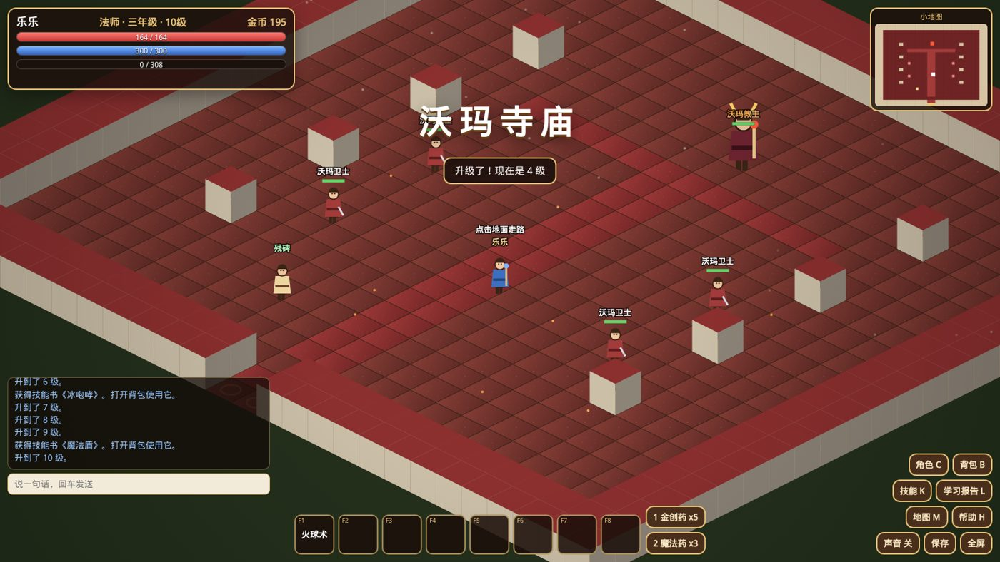

# 传奇学堂

面向小学 1–6 年级的单机冒险。玩法靠近经典传奇：选战士、法师或道士，在新手村、比奇城、森林、僵尸洞和沃玛寺庙里打怪、升级、学技能、换装备。怪物倒下以后会出一道语文或数学题，**答对才有装备、药品和金币**。

画面是程序绘制的原创图，不使用任何商业游戏的图片或素材。进度保存在这台浏览器里，不需要服务器。

在线玩：[https://zhangjianlin0316-stack.github.io/legend-world-edu/](https://zhangjianlin0316-stack.github.io/legend-world-edu/)



## 怎么开始

1. 用浏览器打开仓库根目录的 `index.html`（直接双击即可），或打开上面的网页。
2. 填写名字，选择年级（一年级到六年级）和职业。
3. 进入新手村。点击地面走路，点击怪物战斗。

题目难度跟两个东西有关：你选的年级，以及当前地图。新手村较容易，森林、僵尸洞、沃玛寺庙会用同年级里更难的题。沃玛教主会连续问三题。



## 操作

| 操作 | 作用 |
| --- | --- |
| 点击地面 | 走路 |
| 点击怪物 | 追上去攻击 |
| 点击村民 | 买东西、学技能、听说明、传送 |
| F1–F8 | 释放技能 |
| 1 / 2 | 喝金创药 / 魔法药 |
| C / B / K | 角色 / 背包 / 技能 |
| L | 学习报告（每个知识点的掌握度） |
| M | 地图。去过的地方可以传送 |
| H | 帮助 |
| Esc | 关闭面板 |
| 全屏 | 右下角按钮 |

三个职业：

- **战士**：基本剑术、刺杀剑术、半月弯刀、烈火剑法。血厚，靠近了砍。
- **法师**：火球术、雷电术、冰咆哮、魔法盾。从远处放魔法。
- **道士**：治愈术、灵魂火符、召唤骷髅、隐身术。能给自己补血。

1 级就会第一种技能。3、6、9 级升级时，背包里会出现下一本技能书，打开就能学。比奇城和新手村的导师也可以卖技能书。

装备格子：武器、衣服、头盔、项链、手镯两只、戒指两只。品质分普通、优秀、稀有、史诗、传说。商店能买到普通装备；更好的要从答题掉落里来。



## 答题和掌握度

答对：得到这只怪物的经验、金币，并按几率掉装备、药品或技能书。

答错：看到正确答案和一句说明，只得到少量经验和很少的金币，没有装备。

同一个知识点如果老是错，后面会更常出现。学习报告里，掌握度不到 60% 的条目会标出来。掌握度越高，才越容易掉稀有、史诗和传说装备。刚开始只能见到普通和优秀。



建议路线：新手村的鸡、鹿、稻草人 → 比奇森林的钉耙猫 → 僵尸洞的骷髅和僵尸 → 沃玛寺庙的卫士和教主。等级差得太多时，进门前会提醒你。







被打倒会回到新手村，只掉一点点金币，经验还在。

## 画面

游戏按屏幕的设备像素比绘制，全屏时画布最高到 3840×2160，避免大屏发糊。右下角可以进入全屏。

## 怎么加题目

题库在 `data/questions.json`。现在一共 900 多题，每个年级的语文、数学都不少于 50 题，里面有选择题和填空题。知识点包括拼音、识字、词语、近义词、反义词、成语、古诗、标点、句子，以及加减乘除、口算、分数、小数、单位换算、周长面积、应用题和简易方程。

推荐把新题写进 `data/extra-questions.json`（一个数组），然后在仓库根目录运行：

```bash
node tools/build-questions.mjs
```

这会把内置题和追加题合并，并同时更新 `data/questions.json` 与 `data/questions.js`。直接双击 `index.html` 时，浏览器读的是 `questions.js`；用网页打开时，会优先读 `questions.json`。

如果只改了 `data/questions.json`，运行：

```bash
node tools/sync-questions.mjs
```

一道题长这样：

```json
{
  "grade": 3,
  "subject": "数学",
  "topic": "几何",
  "knowledgePoint": "长方形周长",
  "difficulty": 3,
  "type": "choice",
  "question": "长方形长 6 厘米、宽 4 厘米，周长是多少厘米？",
  "options": ["20", "24", "10", "18"],
  "answer": "20",
  "explanation": "周长 =（长+宽）×2 =（6+4）×2 = 20 厘米。"
}
```

填空题把 `type` 写成 `fill`，`answer` 写成字符串数组，可以放多个可接受的写法。`difficulty` 用 1 到 5：1 最容易，5 留给更深的地图和首领。`grade` 是 1 到 6，`subject` 只能是「语文」或「数学」。

不要运行 `build-questions.mjs` 去覆盖你手改过的 `questions.json`，除非那些改动已经放进 `extra-questions.json`。

## 存档

存档键名是 `legend-academy-save-v1`，在浏览器的 localStorage 里。换电脑、换浏览器，或者清除这个网站的数据，存档会消失。右下角的「保存」会立刻写一次，平时也会自动保存。
